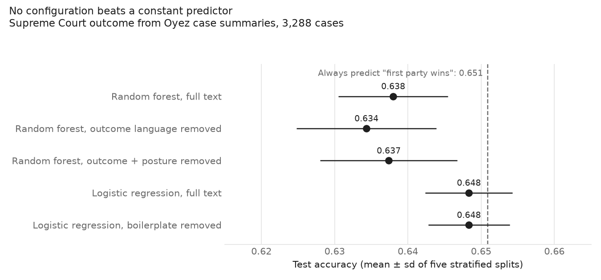

# Predicting Supreme Court outcomes from case narratives: a validation audit

We are trying to answer if a text classifier can predict which side is victorious in a Court case from a summary of its facts.

Based on this dataset, no. We have tried a TF-IDF and Random Forest pipeline and it reaches a **63.8% accuracy against a majority-class baseline of 65.1%**. We tested five configurations and none clear the baseline.

While the pipeline produces a confident-looking ranking of words that supposedly "drive judicial outcomes", it has no demonstrated predictive skill at all. This is a record of the checks that show that, and also what I am trying next.



## Results

Mean of five stratified 80/20 splits. Minority class is "first party loses". The random forest has 300 trees on 1,000 TF-IDF features; logistic regression uses 5,000 features.

| Model | Accuracy | ±sd | AUC | F1 (minority) |
|---|---|---|---|---|
| Majority-class baseline | 0.651 | — | 0.500 | 0.000 |
| Random forest, full text | 0.638 | 0.007 | 0.573 | 0.196 |
| Random forest, outcome language removed | 0.634 | 0.010 | 0.571 | 0.189 |
| Random forest, outcome + posture removed | 0.637 | 0.009 | 0.555 | 0.245 |
| Logistic regression, full text | 0.648 | 0.006 | 0.569 | 0.095 |
| Logistic regression, boilerplate removed | 0.648 | 0.006 | 0.560 | 0.098 |

Under a temporal split (training on terms up to 2011, testing on the 638 cases from 2012 onward), no model or text version beats the 0.671 majority rate on that test set. The random forest on the full text reaches 0.661 (AUC 0.555, mean of five seeds). All seven combinations are in `results_temporal.csv`. The 57 cases dated only by era are left out of this split (see Data).

Random forest results depend on the scikit-learn version. Every number here was produced with scikit-learn 1.4.2, which `requirements.txt` installs on Python 3.12 or earlier. Version 1.4.2 cannot be installed on Python 3.13 and later, so a newer version is installed there instead. With version 1.5 or later, the random forest figures in the table above move by up to 0.008 in accuracy and 0.005 in AUC, and none of them beats the baseline under either version. Logistic regression does not change.

## Why accuracy sits below the baseline

The model is not empty. The random forest's AUC is 0.573, above the 0.500 of a coin toss on every seed, so it ranks cases better than chance.

Accuracy cannot express that, because of the imbalance in targets. 65% of cases go to the first party, so a constant predictor scores 0.651. The model only improves on that by predicting a loss some of the time, and to do so profitably it needs to be more than half confident about a specific case. With this much signal it rarely gets there, and the few times it does are close to coin tosses against a guaranteed win. The result is a score slightly below the constant.

Tuning the decision threshold does not rescue it. Choosing the threshold directly on the test set, an upper bound since that is cheating, takes logistic regression to 0.657 and the random forest to 0.654.

The signal does show up if the output is treated as a ranking rather than a label (logistic regression, full text):

| Predicted-probability quintile | Observed first-party win rate |
|---|---|
| Lowest fifth | 0.59 |
| Corpus mean | 0.65 |
| Highest fifth | 0.73 |

## Why the feature importances cannot be interpreted

The obvious thing to do with a fitted Random Forest is plot the top features and call them the drivers of the outcome. `feature_importances_` always returns a ranking, and it has no way to signal that the model it came from does not work.

Here the top terms are procedural words: *court* (present in 90% of documents), *law*, *appeals*, *district*, *state*, *circuit*. This list comes from one fitted forest; 18 of its top 25 terms recur in the top 25 for all five seeds, so it is a stable description of what the model fits. None of this is an account of what drives judicial outcomes. It is a description of what a skill-less model happened to fit.

A feature importance plot from a model that fails a baseline comparison is not an explanation. It is decoration.

## Running it

```
pip install -r requirements.txt
python run_audit.py           # entry 01 results, feature table, chart
python diagnostics.py         # overfitting, learning curve, label check
python temporal_audit.py      # temporal split, every model and text version
python supporting_checks.py   # the other figures quoted in entry 01
python llm_summary.py         # the figures quoted in entry 02, from results_llm/
```

Each script writes its results as CSV files next to it. Together they take a few minutes.

Entry 02 needs a GPU and the packages in `requirements-llm.txt`, which installs everything the script needs on its own:

```
python finetune_llm.py                               # five stratified splits
python finetune_llm.py --variant text_no_outcome
python finetune_llm.py --temporal                    # five seeds
```

Writes per-run results, predictions, the training loss and a summary to `results_llm/`.

## Log

Each entry states a hypothesis before running it, then reports the result against a fixed baseline of 0.651 accuracy and 0.500 AUC. Those two numbers do not move between entries.

- [01 — TF-IDF baseline audit](01-tfidf-baseline.md) *(2026-09-09; corrected 2026-11-23)* — leakage checks, the boilerplate hypothesis, and what has been ruled out.
- [02 — Fine-tuned small LLM (LoRA)](02-llm-lora.md) *(2026-11-17; first results 2026-11-20; corrected 2026-11-23)* — no better than TF-IDF in a first run (AUC 0.547 against 0.573).

Next, in order:

**03 — Frozen transformer embeddings.** Legal-BERT or a sentence-transformer as a frozen encoder, with a small classifier on the pooled representation. *Hypothesis: AUC improves to roughly 0.62–0.65, because a contextual encoder represents negation and party role that bag-of-words cannot. Accuracy probably still does not clear 0.651.*

**04 — One issue area at a time.** Fit the same models within a single area of law, starting with the two largest (criminal procedure, 859 cases; civil rights, 568). *Hypothesis: within one area, the same words mean more consistent things, so AUC rises above the pooled 0.573; the smaller samples may cancel that out.* The earlier plan to predict the disposition (affirm versus reverse) instead of the winner has been dropped: the two agree in 96.8% of cases (entry 01), so it would be nearly the same target.

**05 — Structured features.** Reproduce the feature set the published literature actually uses, as a reference point for how much of the achievable signal lives outside the narrative text.

**06 — Ranking and calibration.** If the useful output is an ordering rather than a label, evaluate it as one: calibration curves, precision at k, and whether the ranking is stable across seeds.

Stopping when AUC plateaus across two consecutive entries, or after 06.

## Data

Supreme Court judgment data compiled from the [Oyez Project](https://www.oyez.org) API, distributed on Kaggle. 3,288 cases after dropping rows with missing facts or outcome: 3,231 from the terms 1955–2020, and 57 older cases (1789–1955) whose term is recorded as an era rather than a year. The stratified splits use all 3,288; the temporal split uses the 3,231 with a year. One narrative appears twice (*Arizona v. California*, IDs 54829 and 54843, both won by the first party). Both copies are kept; they fall on opposite sides of a split only once (seed 2).

The `facts` field is written by Oyez editors after the decision, but it mostly describes the case up to the Supreme Court's review, including what the lower courts decided. That is what motivates the leakage checks in entry 01, and it also limits what they can show.

Code in this repository is MIT licensed (see `LICENSE`). The dataset is third-party and is not covered by that license.

## Corrections

Each entry keeps its own record. On 2026-11-23, an outside review found mislabelled figures, numbers with no script behind them, a confounded ablation and errors in the text cleaning. All are corrected or documented in entries 01 and 02, and none changes the conclusion. Every output was regenerated with scikit-learn 1.4.2. A second review the same day found two errors in the code added for those corrections, both now fixed (entry 01, Corrections).
